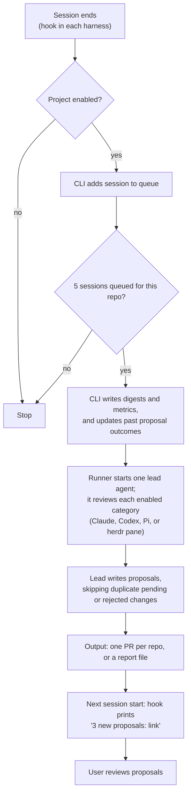
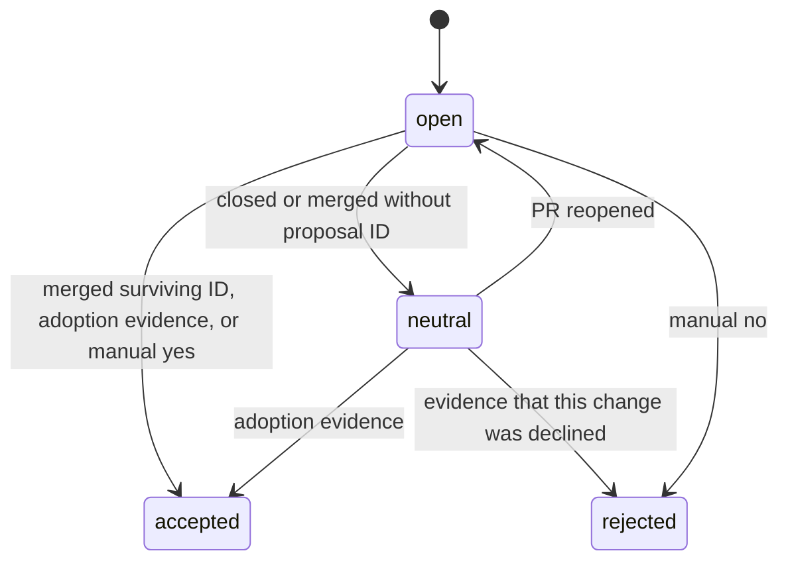

# agentic-retro

agentic-retro ("agentic-retrospective") learns from your finished coding sessions and proposes improvements, as a plugin for Claude Code, Codex, and Pi.

## How a batch runs



- A session-end hook queues sessions only for explicitly enabled repositories (`agentic-retro enqueue`)
- Once a repo has 5 queued sessions (configurable), the CLI starts a batch
- One lead agent runs per batch and waits for each enabled category: code clarity, agent setup, repo changes. It uses subagents when their results can be awaited, otherwise it runs categories sequentially
- Agents write proposals as a PR (one per repo) or a report file, per your setup choice

Collection includes eligible lead and teammate sessions, but never retro's own batch sessions. Attributable human feedback, corrections, and steering carry the strongest evidence in either kind of session; autonomous agent work remains useful, lower-weight evidence. A transcript's `user` role does not prove human authorship: Pi also records parent-agent briefs that way without speaker provenance. Digests mark user-role messages unverified, and finders retain unknown attribution when the source cannot be established.

## The life of a proposal



- Every proposal starts `open` in the ledger (`~/.agentic-retro/ledger.json`)
- Untouched PRs and reports stay open, however long you wait. Closure, silence, and a missing proposal ID are not rejection
- `sync` accepts a proposal whose ID survives in merged PR commits. Closed PRs and merged PRs without that ID become `neutral`, pending inference; reopened PRs return to `open`
- The scheduled `run` agent automatically infers each proposal's outcome from closure explanations and current or replacement source. It records `accepted`, `rejected`, or `neutral` with a reason, evidence URLs, and `inferred` provenance. A mixed PR can adopt documentation while declining automatic installs. Ambiguity remains neutral and is revisited each run
- `mark` records an authoritative manual decision. Neither inference nor sync overrides it. Legacy accepted/rejected entries without provenance are protected too; old automatic verdicts need separate, backed-up historical reconciliation
- `sync` recovers legacy `expired` entries as pending before checking PR state. Old `expireAfterBatches` settings are ignored. It does not invoke a model; semantic inference runs in the existing batch agent
- agentic-retro suppresses duplicate pending or rejected changes, not whole topics. A distinct follow-on improvement can reference a prior proposal without repeating its patch. Changes requiring an unmerged proposal are deferred until their prerequisite lands
- Acceptance rates use only accepted and rejected proposals; open, neutral, and legacy expired proposals do not count as negative feedback. Inferred outcomes are interpretations, not independent human endorsement; inspect their provenance with `ledger --json`
- A no-proposals review records the candidates checked and why they failed the category criteria; it does not imply there is nothing left to improve

## Install

You need Node.js 20 or later.

### Pi: native package

```sh
pi install npm:agentic-retro
```

Restart Pi or run `/reload`, then invoke `/agentic-retro:setup`. This uses the package's bundled CLI, so no global `agentic-retro` install is needed. Select `pi` as the runner harness during setup; installing the package does not change that setting automatically.

Use the CLI from Pi, for example:

```text
/agentic-retro config set runner.harness pi
/agentic-retro project enable
/agentic-retro project status
```

Run the project commands from the repository you want reviewed. Do not also run `install-pi`: loading both the native package and legacy extension duplicates commands and hooks.

### Claude Code and Codex: plugin and CLI

Add the marketplace and install the plugin:

```
/plugin marketplace add ac8318740/ac-agentic-coding
/plugin install agentic-retro@ac-agentic-coding
```

Install the CLI the plugin's hooks call into:

```
npm install -g agentic-retro
```

Run setup, either from the CLI or with the bundled skill:

```
agentic-retro setup
```

```
/agentic-retro:setup
```

- The `setup` skill asks every question itself and writes each answer with `agentic-retro config set`
- `agentic-retro setup` runs the same questions as plain interactive prompts – the human alternative to the skill

Both write the same `~/.agentic-retro/config.json`:

- batch size and grouping
- runner harness and permissions (`auto`, `scoped`, or `bypass`)
- which categories run, and the output mode (PR or report)
- where agent-setup proposals land

Enable collection separately in each repository you want reviewed:

```sh
agentic-retro project enable
agentic-retro project status
# Stop collection and startup notices for this repository:
agentic-retro project disable
```

- Every repository starts disabled, including repositories used before this update
- Run these commands from any worktree or subdirectory, or pass `--cwd <dir>`
- All worktrees share the setting, including worktrees elsewhere on the machine
- Git stores `agentic-retro.enabled` in its shared local configuration, outside tracked files
- Separate clones require separate opt-in
- Disabling retains queued sessions but excludes them from future batches until re-enabled
- Disabling does not stop an already-running batch

For legacy standalone Pi installation only, install the CLI globally and run `agentic-retro install-pi`. This writes an extension file instead of using Pi's native package loader. Choose one installation path; do not load both.

Using Codex? It asks you to trust the new session-end hook the first time a session ends after install.

## Skills

- `run` – the batch agent's own skill; the runner starts it headless once a batch fills. For supervised Pi batches, use the explicit retry command below instead of rerunning the skill manually
- `review` – walks a report, applies each change you accept, and marks the ledger
- `setup` – drives the conversational config walkthrough
- `retro` – reads ledger outcomes and metrics over time into a retrospective

## CLI commands

- `agentic-retro about` – print a short intro to what agentic-retro does
- `agentic-retro setup` – interactive config, the human alternative to the setup skill
- `agentic-retro config list | get <key> | set <key> <value>` – read or write one global config key
- `agentic-retro project enable | disable | status [--cwd <dir>]` – control collection and notices for one repository
- `agentic-retro enqueue` – add a finished session to the queue (hooks call this)
- `agentic-retro propose` – record a new proposal (batch agents call this)
- `agentic-retro link <id>` – attach a PR and commit to a proposal
- `agentic-retro mark <id> <accepted|rejected>` – record an authoritative manual decision on a proposal
- `agentic-retro resolve <id> <accepted|rejected|neutral> --reason <text> --evidence <https-url>` – record the batch agent's inference (repeat `--evidence` for multiple sources). Requires a proposal ID, nonblank reason (at most 4000 characters, no control characters), and 1 to 20 HTTPS evidence URLs without credentials. Evidence is stored, not fetched or executed; the agent must assess its relevance and attribution
- `agentic-retro ledger [--status <s>[,<s>...]] [--json]` – list proposals; JSON includes reasons, evidence, and decision provenance
- `agentic-retro sync` – refresh observable PR state, leave unknown closure intent neutral, and recover legacy inactivity expiries
- `agentic-retro notice` – the session-start one-line proposal count (hooks call this)
- `agentic-retro stats` – acceptance rate per category, and tokens per changed line
- `agentic-retro install-pi` – write a legacy standalone Pi extension (not needed for native packages)
- `agentic-retro batch status <n> [--json]` – inspect a Pi batch's recorded lifecycle
- `agentic-retro batch retry <n>` – explicitly retry a failed or incomplete Pi batch from its preserved manifest
- `agentic-retro batch finish <n> --summary "..."` – the supervised agent's attempt-bound completion handshake

## Pi batch status and recovery

Pi batches run from their batch directory, not the target repository. A missing ACStack configuration there does not mean the target repository is unconfigured.

Each supervised Pi batch keeps `batch.json`, `run.log`, and `status.json` in `batches/<n>/` under the state folder. Queue removal means the agent started, not that it completed. `completed` requires both an explicit finish handshake and exit code 0. A nonzero exit is `failed`; exit 0 without the handshake is `incomplete`. The handshake records the agent's workflow summary, not independent proof that its findings are correct.

From Pi, inspect and recover with:

```text
/agentic-retro batch status 7 --json
/agentic-retro batch retry 7
```

Read `run.log` and the ledger before retrying: a partial run may already have created proposals or PRs. Retry reuses the same manifest and batch number; it does not automatically repeat runs. Active and completed attempts are refused. If a supervisor died, inspect its processes first, then use `batch retry <n> --recover-stale`; recovery refuses a supervisor that is still alive or whose state cannot be determined. Historical batches without status are unverified and require the same explicit inspection and recovery flag.

Detached Pi launches from an enforced ac-teams sandbox are refused, preserving the queue and manifest. The sandbox's access and proxy lifetime belong to its parent; agentic-retro never escapes it or removes access restrictions. Inspect the failure and start recovery later from an authorized independent context with the required access.

Claude Code, Codex, and herdr retain their existing launch behavior; this lifecycle protocol applies only to supervised Pi runs.

## State

- Runtime state lives under `~/.agentic-retro/` (override with `AGENTIC_RETRO_HOME`): config, queue, ledger, metrics, batch digests, and reports
- Repository activation lives in Git's shared local configuration and never enters the tracked checkout
- Keep runtime state outside repositories; Git ignores its own metadata automatically
