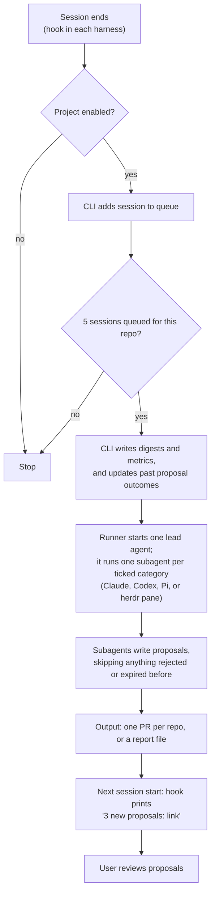
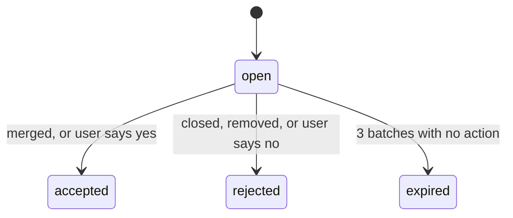

# agentic-retro

agentic-retro ("agentic-retrospective") learns from your finished coding sessions and proposes improvements, as a plugin for Claude Code, Codex, and Pi.

## How a batch runs



- A session-end hook queues sessions only for explicitly enabled repositories (`agentic-retro enqueue`)
- Once a repo has 5 queued sessions (configurable), the CLI starts a batch
- One lead agent runs per batch, and it runs one subagent per ticked category: code clarity, agent setup, repo changes
- Agents write proposals as a PR (one per repo) or a report file, per your setup choice

## The life of a proposal



- Every proposal starts `open` in the ledger (`~/.agentic-retro/ledger.json`)
- It becomes `accepted` or `rejected` once you act on it, or `expired` after 3 batches with no action (configurable)
- agentic-retro never re-proposes a rejected or expired item

## Install

You need Node.js 20 or later.

Add the marketplace and install the plugin:

```
/plugin marketplace add ac8318740/ac-agentic-coding
/plugin install agentic-retro@ac-agentic-coding
```

Install the CLI the plugin's hooks call into:

```
npm install -g agentic-retro
```

Run setup, either from the CLI or with the bundled skill:

```
agentic-retro setup
```

```
/agentic-retro:setup
```

- The `setup` skill asks every question itself and writes each answer with `agentic-retro config set`
- `agentic-retro setup` runs the same questions as plain interactive prompts – the human alternative to the skill

Both write the same `~/.agentic-retro/config.json`:

- batch size and grouping
- runner harness and permissions (`auto`, `scoped`, or `bypass`)
- which categories run, and the output mode (PR or report)
- where agent-setup proposals land

Enable collection separately in each repository you want reviewed:

```sh
agentic-retro project enable
agentic-retro project status
# Stop collection and startup notices for this repository:
agentic-retro project disable
```

- Every repository starts disabled, including repositories used before this update
- Run these commands from any worktree or subdirectory, or pass `--cwd <dir>`
- All worktrees share the setting, including worktrees elsewhere on the machine
- Git stores `agentic-retro.enabled` in its shared local configuration, outside tracked files
- Separate clones require separate opt-in
- Disabling retains queued sessions but excludes them from future batches until re-enabled
- Disabling does not stop an already-running batch

Using Pi? Run `agentic-retro install-pi` once. Pi has no hook config, so this extension queues finished Pi sessions and shows the notice.

Using Codex? It asks you to trust the new session-end hook the first time a session ends after install.

## Skills

- `run` – the batch agent's own skill; the runner starts it headless once a batch fills, and you can also invoke it to rerun a batch
- `review` – walks a report, applies each change you accept, and marks the ledger
- `setup` – drives the conversational config walkthrough
- `retro` – reads ledger outcomes and metrics over time into a retrospective

## CLI commands

- `agentic-retro about` – print a short intro to what agentic-retro does
- `agentic-retro setup` – interactive config, the human alternative to the setup skill
- `agentic-retro config list | get <key> | set <key> <value>` – read or write one global config key
- `agentic-retro project enable | disable | status [--cwd <dir>]` – control collection and notices for one repository
- `agentic-retro enqueue` – add a finished session to the queue (hooks call this)
- `agentic-retro propose` – record a new proposal (batch agents call this)
- `agentic-retro link <id>` – attach a PR and commit to a proposal
- `agentic-retro mark <id> <accepted|rejected>` – record a decision on a proposal
- `agentic-retro ledger` – list proposals, filtered by status
- `agentic-retro sync` – refresh proposal outcomes from GitHub, then expire stale ones
- `agentic-retro notice` – the session-start one-line proposal count (hooks call this)
- `agentic-retro stats` – acceptance rate per category, and tokens per changed line
- `agentic-retro install-pi` – write the Pi extension that stands in for Pi's missing hooks

## State

- Runtime state lives under `~/.agentic-retro/` (override with `AGENTIC_RETRO_HOME`): config, queue, ledger, metrics, batch digests, and reports
- Repository activation lives in Git's shared local configuration and never enters the tracked checkout
- Keep runtime state outside repositories; Git ignores its own metadata automatically
